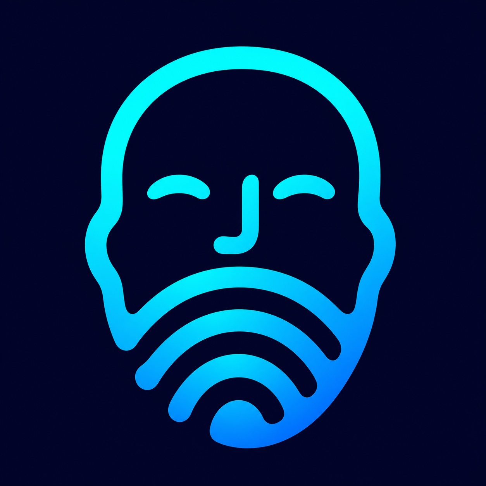

# Faceprint



**Faceprint 0.1.1-beta.2** brings local face recognition to macOS password prompts. It recognizes your enrolled face, fills your saved Mac password, and can optionally press Return after verifying the fill.

Faceprint is built on **Glance**, created by **Jonathan Zhou**, with substantial direct reuse of its recognition, enrollment, and Dynamic Island code and assets. Full attribution and the original MIT license are included in this repository and the app. [Glance](https://github.com/jonnyoo/glance) · [Third-party notices](THIRD_PARTY_NOTICES.md)

## Features

- Local ArcFace recognition with Glance's nine-direction, 18-sample enrollment.
- Original and Minimal Dynamic Island styles, with the upstream scanning and result animations.
- Password filling for Privacy & Security and native Passwords AutoFill prompts, including AutoFill for Dia.
- Optional automatic Return after a verified real-password fill, off by default.
- Test mode that fills a single `x` and always leaves confirmation to you.
- Launch at login through macOS Login Items, with an explicit opt-in switch.
- First-launch Camera and Accessibility permission requests, with visible permission status.
- Encrypted password and face templates, with a Secure Enclave protected session key.

## Download and run

Download the Apple Silicon app ZIP from Releases, extract it, and place Faceprint.app in a stable location such as Applications before granting permissions. The beta is locally ad-hoc signed. [Releases](https://github.com/Er1cG1ao/faceprint/releases)

1. Put Faceprint in Applications and open it. On first launch it requests Camera and Accessibility access; approve those in macOS. The Startup & Permissions section shows anything still needed.
2. Click Unlock session and complete the macOS authentication request. This authorizes local access to your encrypted saved data until the session locks.
3. Select your camera, allow Camera access, and enroll your face using the nine-direction guide.
4. Save your Mac login password in Faceprint, and grant it Accessibility access.
5. Keep Test mode enabled for the first test, then enable face-assisted filling.
6. Open a supported system password prompt yourself and select Use Password… so the empty password field is focused. Faceprint starts recognition automatically.
7. Check for one dot and click Cancel. After that test works, turn filling off, turn Test mode off, and enable filling again.

Dynamic Island style and automatic Return can be changed while filling is disabled. With automatic Return off, review the request and click Modify Settings or OK yourself. With it on, Faceprint confirms the current supported dialog after verifying that the password field received the expected text length. Test mode never sends Return.

Enable **Launch Faceprint at login** under Startup & Permissions to register it with macOS. If macOS requires approval, use Open Login Items. Turning the switch off unregisters it. Login launch does not unlock the encrypted vault or enable filling automatically.

## Beta scope

This build targets Apple Silicon and macOS 15 or later. Native Passwords AutoFill matching currently uses the English dialog wording. Supported processes and context checks are defined in PromptPolicy.swift and PromptTarget.swift. A filled status verifies field input. The system dialog determines whether the password is correct and whether the requested action succeeds.

Recognition uses an ordinary RGB camera. Default face matching can accept photos or replayed video. Optional passive photo checks use Glance's Light mode and do not require blinking or head turns. Automatically confirming administrator prompts can apply privileged changes, so review that setting for your use.

The beta uses InsightFace pretrained weights through Glance. Those weights have separate non-commercial research terms. The MIT license for the code does not add rights to the pretrained weights. [Third-party notices](THIRD_PARTY_NOTICES.md)

## Local data

Camera images are processed locally in memory. Face embeddings and the saved password are encrypted separately with AES-GCM. A user-presence-protected Secure Enclave P-256 key derives the session key through ECDH and HKDF-SHA256. Sessions lock after 30 minutes without secret use, on screen lock, sleep, user-session switch, or quit.

The renamed app retains the prototype's local vault location and key-derivation context so existing enrolled faces and passwords can be opened. The vault is under `~/Library/Application Support/GlanceFill/vault-v1.json`. Fresh Faceprint preferences use `io.github.er1cg1ao.faceprint`. The opaque hardware-key representation is device-bound. Possession of it can let another process initiate an authentication request, and deriving the session key still requires the hardware-enforced user-presence check.

## Build

Install Apple Command Line Tools on an Apple Silicon Mac and have Glance installed locally. The setup script imports the same compiled model and scan-animation assets from that installation. Runtime binaries are excluded from the source repository.

```bash
git clone https://github.com/Er1cG1ao/faceprint.git
cd faceprint
bash setup-resources.sh
bash build.sh
bash test.sh
```

Pass another Glance app path to `setup-resources.sh` if needed. The output is `Faceprint.app`. Source under `Sources/Upstream` is reused or adapted from Glance revision `b97f521397ec1197ba17768ba797cae1e628848d`.

## License and acknowledgements

Faceprint code is MIT licensed, with the original Glance notice preserved for reused components. Thanks to Jonathan Zhou for Glance and to InsightFace's authors for the face-recognition model. Model terms are listed separately. [MIT license](LICENSE) · [Glance license](LICENSE-Glance.txt) · [Third-party notices](THIRD_PARTY_NOTICES.md)
