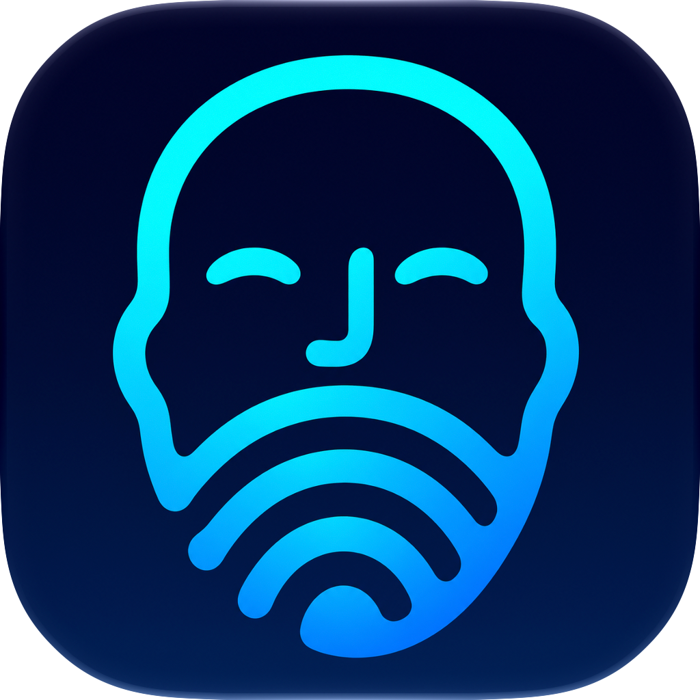

<p align="center">
  
</p>

# Faceprint

**看一眼，少输一次密码。**

一个原生 macOS 菜单栏应用：识别你的脸，将保存的 Mac 密码填入受支持的系统弹窗。打开密码输入框，看向摄像头，再确认当前请求。灵动岛会显示识别进度与结果。

[English](README.md) · **简体中文**

[下载 Beta](https://github.com/Er1cG1ao/faceprint/releases/tag/v0.1.1-beta.2) · [使用教程](Docs/TUTORIAL.zh-CN.md) · [开发说明](Docs/DEVELOPMENT.md) · [反馈问题](https://github.com/Er1cG1ao/faceprint/issues)

基于 [**Jonathan Zhou 的 Glance**](https://github.com/jonnyoo/glance) 开发，直接复用了人脸识别、多方位录入、灵动岛相关代码与素材。软件内及[第三方声明](THIRD_PARTY_NOTICES.md)保留了原作者署名和许可证。

## 能做什么

- **九方向人脸录入：**通过 Glance 的引导圆环与摄像头预览采集 18 个样本，使用相同的 ArcFace 模型。
- **填写系统密码弹窗：**支持“隐私与安全性”及原生“密码”自动填充验证，包括 Dia 的 AutoFill 弹窗。
- **灵动岛状态反馈：**提供 Original 与 Minimal 两种动画样式，兼容有刘海和无刘海的显示器。
- **自主选择提交方式：**默认填完后手动确认，也可开启验证填入后自动回车。测试模式只输入 `x`，始终不提交。
- **本地加密保存：**密码和人脸模板在本机加密，通过 macOS 验证打开受 Secure Enclave 保护的会话。
- **便于日常使用：**首次权限申请、权限状态提示、摄像头选择，以及可选的登录时启动。

使用 Swift、SwiftUI、AppKit、AVFoundation 和 Core ML 构建，人脸处理在本机完成。软件界面目前为英文，文档提供英文和简体中文。

### 当前测试版：0.1.1 Beta 2

加入 Faceprint 图标、开机自启设置和首次权限引导；针对录脸时启动摄像头的崩溃，以及会话验证后窗口跑到后面的问题进行了修复。构建和现有测试已通过，完整录脸及窗口焦点表现仍需实际使用验证。详见[版本说明](RELEASE_NOTES.md)。

## 安装与开始使用

需要 **Apple Silicon（M 系列）Mac、macOS 15 或更新版本**，目前不提供 Intel 安装包。

1. 在 [Beta 发布页](https://github.com/Er1cG1ao/faceprint/releases/tag/v0.1.1-beta.2)的 **Assets** 中下载 `Faceprint-0.1.1-beta.2-macos-arm64.zip`。
2. 退出旧版，解压 ZIP，将 `Faceprint.app` 放入 **Applications（应用程序）**，然后再授权或启用开机自启。
3. 打开 Faceprint，允许**摄像头**与**辅助功能**权限。点击 **Unlock session**，完成 macOS 身份验证。
4. 选择摄像头，按照九方向引导录入人脸，并保存你的 Mac 登录密码。
5. 保持 **Test mode** 开启，启用填写。在支持的系统弹窗中，必要时先点 **Use Password…**，让空密码框获得焦点；看到一个密码圆点后，点击 Cancel。
6. 测试成功后，先关闭填写，取消 Test mode，再重新启用填写。

使用时保持 Faceprint 运行。关闭设置窗口后应用仍留在菜单栏；退出应用会停止识别并锁定会话。开机自启后，已保存的数据仍保持锁定。会话、自动回车、照片检查和排错方法见[使用教程](Docs/TUTORIAL.zh-CN.md)。

发布的 Beta 使用临时签名，**尚未经过 Apple 公证**。

## 支持范围与隐私

- 仅支持指定的 Apple 系统密码弹窗。你打开密码输入界面后，Faceprint 才进行填写；它不会替换 macOS Touch ID、解锁锁屏或提供 Face ID 硬件。
- 使用普通 RGB 摄像头，**照片或回放视频也可能通过识别**。可选的 Glance Light 照片检查能拒绝部分明显的冒充，也可能误判真人，无法可靠防住所有回放。
- 原生“密码”AutoFill 匹配目前依赖英文弹窗文字。填入验证检查输入长度；密码是否正确、操作是否成功，由 macOS 决定。
- 自动回车**默认关闭**。开启后可能直接确认具有管理员权限的设置修改；测试模式始终由你手动确认。
- 摄像头画面仅在内存中处理，保存的人脸特征和密码在本机加密。锁屏、睡眠、切换用户会话、退出应用或 30 分钟未使用加密数据后，会话重新锁定。详见[本地数据与隐私](Docs/TUTORIAL.zh-CN.md#本地数据与隐私)。
- InsightFace 预训练权重适用独立的**非商业研究条款**，代码的 MIT 许可证不赋予额外的模型使用权。详见[第三方声明](THIRD_PARTY_NOTICES.md)。

## 从源码构建

在 Apple Silicon Mac 上安装当前版本的 Apple Command Line Tools，并在本机安装 Glance，以导入其已编译模型和动画素材。

```sh
git clone https://github.com/Er1cG1ao/faceprint.git
cd faceprint
bash setup-resources.sh
bash build.sh
bash test.sh
```

输出为 `Faceprint.app`，构建不会自动安装或发布应用。资源导入、源码结构、测试及打包方式见[开发说明（英文）](Docs/DEVELOPMENT.md)。

## 反馈与参与

欢迎通过 [Issues](https://github.com/Er1cG1ao/faceprint/issues) 反馈，附上 Faceprint 版本、macOS 版本、摄像头型号、复现步骤，以及预期和实际结果。分享日志或截图前请移除私人信息，**不要上传密码、人脸模板、摄像头录像或本地 vault 文件**。

[中文教程](Docs/TUTORIAL.zh-CN.md) · [English guide](Docs/TUTORIAL.md) · [开发说明](Docs/DEVELOPMENT.md) · [版本说明](RELEASE_NOTES.md)

## 许可证与项目来源

Faceprint 代码采用 [MIT](LICENSE) 许可证，复用部分保留 [Glance 原始 MIT 声明](LICENSE-Glance.txt)。感谢 **Jonathan Zhou** 开发 Glance，感谢 **InsightFace 作者**提供人脸识别模型。Faceprint 图标由 AI 图像生成工具创作，原始图稿位于 [`Branding/Faceprint.png`](Branding/Faceprint.png)。上游版本与模型条款见[第三方声明](THIRD_PARTY_NOTICES.md)。
